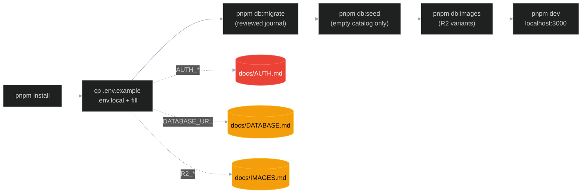
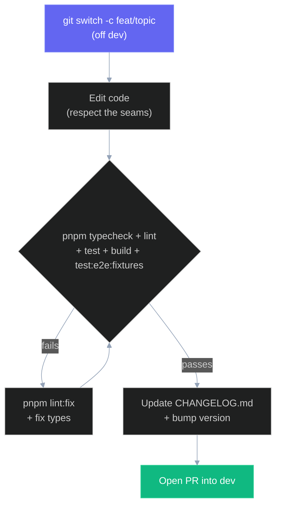

# Local Development

How to get [kalchar.co.in](https://kalchar.co.in/) running on your machine and the conventions a contributor has to follow. This doc covers prerequisites, first-time setup, the full script reference, local-dev gotchas, and the project rules that govern every change. Start at [ARCHITECTURE.md](ARCHITECTURE.md) for the system picture; come here when you are ready to run the app or open a PR.

## Prerequisites

| Tool | Version | Why |
| --- | --- | --- |
| Node | `24` | [.nvmrc](../.nvmrc), matching CI and Vercel; [package.json](../package.json) `engines.node` still allows `>=22` |
| pnpm | `10.34.6` | pinned in [package.json](../package.json) `packageManager` -- use Corepack (`corepack enable`) so the exact version is used |
| Git | any recent | branches PR into `dev` (see [Conventions](#conventions)) |

The app builds and serves against three external services. You need credentials for full function, but not all three to start:

| Service | What it backs | Without it |
| --- | --- | --- |
| Neon Postgres | catalog, events, settings, lookups, leads, testimonials, and allowlist | real-data builds fail when catalog queries cannot connect. Get a separate development `DATABASE_URL` per [DATABASE.md](DATABASE.md). |
| Cloudflare R2 | artwork image variants | `<picture>` srcsets 404. Get the `R2_*` values per [IMAGES.md](IMAGES.md). |
| Google OAuth | admin sign-in | `/admin` is unreachable. Get `AUTH_GOOGLE_ID` / `AUTH_GOOGLE_SECRET` per [AUTH.md](AUTH.md). |

Several marketing pages also read profile settings, examples, workshops, and presets from Neon. Synchronous site copy alone does not make a normal production build independent of the database. For public UI work and CI, `KALCHAR_TEST_FIXTURES=1` supplies deterministic catalog rows through the data seam and maps media to safe local assets. It does not grant admin access or permit database writes and is rejected on Vercel.

## Without secrets

To look at or change the UI before any credentials exist:

```sh
corepack enable
pnpm install
pnpm dev:preview  # http://localhost:3010, fixture catalog, /admin without sign-in, nothing saves
```

See [Preview the admin without signing in](#local-dev-notes) for what the preview can and cannot do, and [Browser tests](#browser-tests) for the fixture-backed Playwright run. Both work with no `.env.local`.

## First-time setup

`.env.local` is gitignored. The contract for what goes in it lives in [.env.example](../.env.example); copy it and fill in real values. Never commit secrets.

```sh
# 1. Use the pinned pnpm and install deps.
corepack enable
pnpm install

# 2. Create your local env file from the template, then fill it in.
cp .env.example .env.local
#   AUTH_SECRET, AUTH_GOOGLE_ID, AUTH_GOOGLE_SECRET  -> docs/AUTH.md
#   DATABASE_URL                                     -> docs/DATABASE.md
#   R2_* and NEXT_PUBLIC_IMAGE_BASE_URL              -> docs/IMAGES.md
#   (NEXT_PUBLIC_IMAGE_BASE_URL is the same value as R2_PUBLIC_BASE_URL,
#    exposed to the client because the gallery is a client component.)

# 3. Validate and apply committed migrations to an isolated database.
node scripts/check-migrations.mjs
pnpm db:migrate

# 4. Bootstrap an empty catalog once. Existing content/settings cause refusal.
pnpm db:seed

# 5. Upload the image variants from public/artworks/ to R2.
pnpm db:images

# 6. Run the dev server.
pnpm dev          # http://localhost:3000
pnpm dev --port 3002  # alternate when 3000 is occupied (3001 is the browser-test port);
                      # register the matching OAuth callback and R2 CORS origin
```

Seeding is one-time, not a way to replay changed JSON or restore deleted items. Future schema changes use new reviewed migrations. The image command writes stable seed keys and needs its own deliberate regeneration window. Day-to-day work is `pnpm dev`. The maintainer allowlist is the `maintainers` table, not an env var; provision the first root separately as described in [AUTH.md](AUTH.md). Catalog seeding does not create an account.

An existing database created with `db:push` must follow the [baseline procedure](DATABASE.md#existing-database-created-with-dbpush) before using migration history. Never apply the full journal blindly to an already-pushed schema.



## Scripts reference

Every script from [package.json](../package.json), what it runs, and when you reach for it.

| Script | Runs | When |
| --- | --- | --- |
| `pnpm dev` | `next dev --turbopack` | Day-to-day local server with HMR (Turbopack). The default. |
| `pnpm dev:preview` | `node scripts/admin-preview.mjs` | Dev server on port 3010 over the fixture catalog with a synthetic maintainer. No secrets, nothing saves. See [Local dev notes](#local-dev-notes). |
| `pnpm build` | `next build` | Production build: SSG of the public pages from Neon + the dynamic admin/api routes. Run before a PR to catch build-time failures. |
| `pnpm start` | `next start` | Serve the output of `pnpm build` locally. Rarely needed -- Vercel does this in prod. |
| `pnpm lint` | `biome check` | Lint + format-check (no writes). What CI runs; run it before pushing. |
| `pnpm lint:fix` | `biome check --write` | Apply Biome's safe lint fixes and formatting in place. |
| `pnpm format` | `biome format --write` | Format only (no lint rules), in place. |
| `pnpm typecheck` | `next typegen && tsc --noEmit` | Generates `next-env.d.ts` and the route types, then runs the strict TypeScript check with no emit. Run before a PR alongside lint. `next-env.d.ts` is generated, gitignored and never edited by hand. |
| `pnpm typecheck:scripts` | `tsc --project tsconfig.scripts.json` | Check operational scripts, including JavaScript via `checkJs`. |
| `pnpm typecheck:tests` | `tsc --project tests/admin/tsconfig.json` | Check the browser fixture harness under `tests/admin/`. |
| `pnpm test` | `vitest run` | Unit tests for domain helpers, validation, rate limiting, and storage compensation. |
| `pnpm test:watch` | `vitest` | The unit suite in watch mode while editing. |
| `pnpm test:e2e` | `playwright test` | Desktop and mobile Chromium checks, including axe accessibility scans, against the current `.next` build on port 3001. The public specs assert fixture rows, so the build must be a fixture build. |
| `pnpm test:e2e:fixtures` | `node scripts/e2e-fixtures.mjs` | Fixture build, then the full Playwright suite, the way CI runs it. No secrets. Extra arguments go to Playwright (`--shard=1/4`, `-g "lightbox"`). |
| `pnpm test:preview` | `node scripts/e2e-fixtures.mjs --preview` | The `@preview` admin geometry suites (`tests/admin/playwright.config.ts`, `--grep @preview`) against a running `pnpm dev:preview`. |
| `pnpm test:operations` | `node --test scripts/operational.test.mjs` | Exercise malformed migration artifacts, baseline drift, backup integrity, and public health without external resources. |
| `pnpm test:all` | unit + browser suites | Full automated test pass after a fixture build. |
| `pnpm health` | `node scripts/health-check.mjs` | Check public catalog links, sampled detail pages, and real media bytes as well as core endpoints. |
| `pnpm db:validate` | `node scripts/check-migrations.mjs` | Offline artifact validation: journal numbering/timestamps, SQL files, and snapshot ancestry. |
| `pnpm db:check` | `tsx scripts/check-migrations-db.ts` | Disposable PostgreSQL integration check. Apply migrations twice; check bootstrap refusal/concurrency and category constraints. Requires local `MIGRATION_TEST_DATABASE_URL` with database `kalchar_migration_test`. |
| `pnpm db:push` | `drizzle-kit push` | Push schema directly to a disposable local database only. |
| `pnpm db:generate` | `drizzle-kit generate` | Generate the reviewable SQL migration required for a schema change. |
| `pnpm db:migrate` | `drizzle-kit migrate` | Apply the generated migration files to the database. |
| `pnpm db:seed` | `tsx --env-file-if-exists=.env.local scripts/migrate-json-to-db.ts` | Locked one-time catalog bootstrap with a persistent marker. Refuses populated content/settings. |
| `pnpm db:images` | `tsx --env-file-if-exists=.env.local scripts/migrate-images-to-r2.ts` | Generate + upload artwork image variants from `public/artworks/` to R2. One-time per environment. `--dry-run` lists inputs without R2. |
| `pnpm r2:cors` | `tsx --env-file-if-exists=.env.local scripts/set-r2-cors.ts` | Apply the bucket CORS policy browser uploads need. Needs an admin-scoped R2 token; see [IMAGES.md](IMAGES.md). |
| `pnpm r2:cleanup` | `tsx --env-file-if-exists=.env.local scripts/cleanup-staging.ts` | List `staging/` objects older than 24 hours; `--apply` deletes them. |

`db:seed`, `db:images`, `r2:cors`, and `r2:cleanup` load `.env.local` if it exists and also accept explicitly supplied environment variables; a missing value fails with the [lib/env.ts](../lib/env.ts) error naming the variable. Drizzle Kit loads the file through its configuration. Offline migration, baseline, backup, and script checks do not load that file. The disposable PostgreSQL check accepts only its separate test URL. See [DATABASE.md](DATABASE.md) for migration/baseline commands, [IMAGES.md](IMAGES.md) for image writes, and [OPERATIONS.md](OPERATIONS.md) for offline backup verification.

### Browser tests

The Playwright specs assert the fixture catalog, so they run against a fixture build, the same way CI does. [scripts/e2e-fixtures.mjs](../scripts/e2e-fixtures.mjs) sets the environment itself, so the commands are identical in PowerShell, cmd, and POSIX shells:

```sh
pnpm exec playwright install chromium  # once, and again after a Playwright upgrade
pnpm test:e2e:fixtures                 # KALCHAR_TEST_FIXTURES=1 build, then the full suite on port 3001
pnpm test:e2e:fixtures --shard=1/4     # extra arguments go to Playwright
```

The script sets `KALCHAR_TEST_FIXTURES=1`, `NEXT_PUBLIC_IMAGE_BASE_URL=https://fixtures.invalid`, and a throwaway `AUTH_SECRET` (unless one is already exported), matching `.github/workflows/ci.yml`. A build over real `.env.local` data fails the public specs. Keep fixture builds separate from real-data builds: the fixture build replaces `.next`, so run `pnpm build` again before serving real data. Fixture mode intentionally refuses all database access and maintainer admission.

The four `@preview` suites (`admin-catalog-layout`, `admin-categories-usability`, `admin-presets-usability`, `admin-content-layout`) measure real-page geometry, so they skip in the normal run. Start `pnpm dev:preview`, then in a second terminal:

```sh
pnpm test:preview  # tests/admin/playwright.config.ts --grep @preview, KALCHAR_ADMIN_PREVIEW=1
```

That config does not match `admin-content-layout.spec.ts` yet, so `test:preview` currently covers the first three suites.

## Local dev notes

**In-app DevTools panel is off.** [next.config.mjs](../next.config.mjs) sets `devIndicators: false`. The panel first shipped in Next 15.5 where, on Windows + pnpm, its `segment-explorer-node` module drifted out of sync with the React Client Manifest after a hot reload and crashed client-component pages until the dev server was restarted. Kept off as a dev-stability flag; the panel adds nothing here and production builds never include it.

**Trailing slashes.** `trailingSlash: true` keeps the canonical `/work/` URL shape the site has always used, preserving links and SEO from the earlier static era. Author internal links with the trailing slash to match.

**No Next image optimizer.** `images.unoptimized: true`. The gallery serves artwork from Cloudflare R2 through a hand-rolled `<picture>` element ([lib/image-base.ts](../lib/image-base.ts)), not `next/image`, so Next's optimizer is intentionally off. See [IMAGES.md](IMAGES.md) for how the srcset is built.

**Preview the admin without signing in.** `pnpm dev:preview` ([scripts/admin-preview.mjs](../scripts/admin-preview.mjs)) starts the dev server on port 3010 with `KALCHAR_TEST_FIXTURES=1` and `KALCHAR_ADMIN_PREVIEW=1`, so every `/admin` page renders as the synthetic maintainer `preview@kalchar.invalid` over the read-only fixture catalog, leads inbox, roster and presets included. Nothing can be saved: the database proxy and the R2 client both throw in fixture mode, a banner under the header says so, and [lib/env.ts](../lib/env.ts) refuses both flags when `VERCEL=1`. Use it for design review, screenshots and responsive checks; behaviour that writes still needs Google sign-in on `pnpm dev`.

**Biome 2 is the one tool.** [biome.json](../biome.json) is both formatter and linter, and it runs in CI plus on save. Key settings to write code that passes without a fix pass:

| Setting | Value |
| --- | --- |
| Indent | tabs, width 2 (`formatter.indentStyle: "tab"`) |
| Line width | 100 |
| Line ending | `lf` |
| Quotes | double (JS + JSX), semicolons always, trailing commas `all` |
| JSON | trailing commas `none` |
| Imports | `organizeImports` on (assist), `useImportType` warns -- use `import type` for types |
| Lint base | `recommended` on; `noExplicitAny` warns; `noNonNullAssertion` off |

Biome's `vcs.useIgnoreFile` is on, so `.gitignore`d paths are skipped; `.next`, `out`, `node_modules`, `_opt`, and `pnpm-lock.yaml` are explicitly excluded in `files.includes`.

## Conventions

These are the project rules from [CLAUDE.md](../CLAUDE.md) that gate every contribution. Read them before writing code -- a PR that breaks an architectural seam or a copy rule gets sent back.

**Architecture (the seams).**

- **Catalog reads go through [lib/data.ts](../lib/data.ts) only.** Never query Neon or `import data/*.json` anywhere else. The async getters map DB rows to the UI types. `getSite()` stays synchronous because `app/layout.tsx` consumes it at module top-level where `await` cannot reach.
- **Image URLs come from [lib/image-base.ts](../lib/image-base.ts).** Browser surfaces use the same-origin `ARTWORK_IMAGE_BASE`; external metadata and server operations use the absolute R2 builders.
- **Admin mutations are server actions**, one module per entity family: the catalog in `app/admin/artwork-actions.ts`; workshops, presets, categories, and the maintainer roster in `app/admin/actions.ts`; events and profile settings in `app/admin/event-actions.ts`; leads in `app/admin/lead-actions.ts`; testimonials in `app/admin/testimonial-actions.ts`; presigned upload tickets in `app/admin/upload-actions.ts`. Every export runs through `runAdminAction` (`lib/admin-action.ts`), which re-checks the maintainer session (`lib/admin-auth.ts`) and returns failures as data, and ends with `revalidateEntity(...)` from `lib/revalidate.ts`, the one map of which routes render which entity.
- **URLs come from `lib/site-config.ts`** (`siteConfig.url` / `prodUrl`). One source.
- **500-line file ceiling.** Split before committing -- extract a sub-component, lift styles, or pull data into JSON.
- **Data files live at repo root** (`data/`), not under `src/`.

**Visual / motion.**

- **Mobile-first.** Most traffic is WhatsApp / Instagram link-taps on phones. Design for phone width first, then scale up.
- **Motion always on.** `MotionConfig reducedMotion="never"` (`components/motion/motion-provider.tsx`) keeps animation running whatever the OS reduced-motion setting, since 1.39.0.
- **No raw hex / rgb in components.** Browser-rendered color flows through CSS custom properties. The only exceptions are `data/artworks.json` palette arrays, SVG data URIs, and pre-CSS/server image outputs that import the named constants in `lib/server-brand-colors.ts`.
- **No magic timings.** Use the named tokens (`--duration-fast/base/slow`, `--ease-out-soft/glide/spring`).
- **Consistent corner radius.** `rounded-md` on every surface (cards, panels, fields, buttons, image plates). Pills and the theme toggle stay `rounded-full`. No sharp corners.
- **Section pigment accents.** about=marigold, workshops=pichwai, custom-orders=vermillion, contact=peacock; hero + Selected Work inherit global terracotta. Set via `--section-accent` inline on `<main>` or a `Section` wrapper.

**Copy.**

- **No double-dash glyph in user-facing copy.** Banned in metadata, JSX strings, page bodies, dropdown options, and `data/*.json`. Replace with a comma, period, colon, parentheses, or restructure. Internal code comments, JSDoc, and these docs may keep `--` since they do not ship.
- **No emojis** in user-facing copy or commits unless explicitly asked.
- **Voice** is neutral first-person plural ("we'll get back to you"), not third-person by name. Exception: `data/site.json` artist-voice copy, where the artist speaks in first-person singular and we do not rewrite her words.

**Git workflow.**

- **Branch off `dev`.** Feature branches are `feat/*`, `fix/*`, `chore/*`; they PR into `dev`. `main` is branch-protected.
- **Conventional commits:** `feat`, `fix`, `refactor`, `docs`, `test`, `chore`. Lowercase, imperative, no trailing period.
- **Update [CHANGELOG.md](../CHANGELOG.md) and bump `package.json` `version` on every PR.** Patch (`x.y.Z`) for narrow fixes/content changes, minor (`x.Y.0`) for new capabilities or content-model changes, and major for breaking product milestones. Add a real top entry under the chosen version, no `[Unreleased]` placeholder.
- **Never push without explicit per-session approval.** Never force-push `main`, amend published commits, or skip hooks (`--no-verify`). Stage files by name, never `git add .`.

## Making a change

The loop for a typical contribution. The directory map is in [ARCHITECTURE.md](ARCHITECTURE.md#repository-map) -- not duplicated here.



Adding something new rather than changing something? [ADDING-FEATURES.md](ADDING-FEATURES.md) is the ordered checklist for a new entity, public page, image-bearing feature, or environment variable.

Local verification mirrors CI: lint, application/script typechecks, unit and operational checks, migration application, build, and Playwright. The public fixture build and disposable database tests serve different purposes; neither proves production OAuth, bucket policies, or restore readiness. Run the actual changed behavior in its appropriate isolated environment. See [DEPLOYMENT.md](DEPLOYMENT.md) for release gates.
